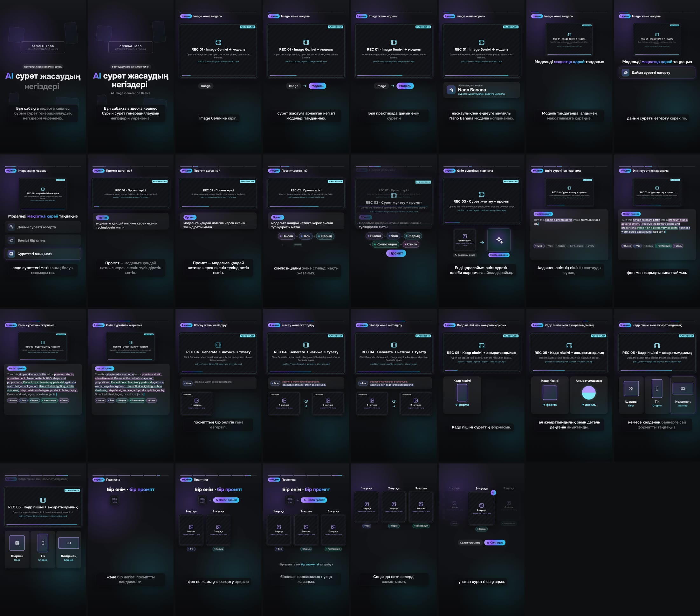

# AI сурет жасаудың негіздері · Higgsfield (KK)

Instagram-ға арналған тік (9:16) моушн-дизайн сабағы: Higgsfield-те AI сурет
генерациялаудың негіздері, қазақ тіліндегі дикторлық мәтін мен субтитрлер.

A ~90 s vertical (1080×1920, 30 fps) motion-design tutorial in Kazakh about the
fundamentals of AI image generation in Higgsfield, built with
[Remotion](https://www.remotion.dev/) (React → video).



## What's in the project

| Done | Needs your real assets |
|---|---|
| Full motion design for all 8 storyboard sections | Official Higgsfield logo → `public/brand/` |
| Kazakh narration of the full script (TTS) + Kazakh captions synced to it | 5 screen recordings of the real Higgsfield site → `public/recordings/` |
| Prompt formula (Нысан · Фон · Жарық · Композиция · Стиль), colour-coded prompt highlighting, iteration diff, shape cards, variation grid, recap | Reference photo + real Higgsfield results → `public/images/` |
| Quiet original music bed, subtle UI sounds, voice ducking | |
| Slots with trims, zoom and callouts for the recordings | |

Missing files render as clearly labelled **PLACEHOLDER** panels, so the video
always renders. Drop the files in and re-render; no code changes are needed.
**→ [docs/SHOT_LIST.md](docs/SHOT_LIST.md)** has the exact shots, prompts and
file names.

The project never draws the Higgsfield interface or logo itself, and never fakes
generated images. Those always come from your recording and Higgsfield's files.

## Quick start

```bash
npm install
npm run studio      # live preview + timeline scrubbing in the browser
npm run render      # -> out/higgsfield-image-basics-kk.mp4
npm run stills      # review frames + docs/storyboard.jpg
npm run check       # TypeScript
```

Remotion downloads its own headless Chrome on first render. To use an existing
Chromium instead, set `REMOTION_BROWSER_EXECUTABLE=/path/to/chrome`.

## Timeline

Scene lengths follow the narration (`src/timeline.ts`); a sentence is never cut.

| Section | Storyboard | This cut |
|---|---|---|
| Intro: logo + title | 0–6 s | 0.0–6.5 s |
| 1 · Image + model choice | 6–17 s | 6.1–28.2 s |
| 2 · What is a prompt? | 17–27 s | 27.8–37.8 s |
| 3 · Product photo → ad | 27–49 s | 37.4–52.9 s |
| 4 · Generate, review, improve | 49–59 s | 52.5–63.0 s |
| 5 · Aspect ratio + resolution | 59–70 s | 62.6–73.8 s |
| 6 · Practice (1-, 2-, 3-нұсқа) | 70–85 s | 73.4–84.9 s |
| Wrap-up: recap + logo | 85–90 s | 84.5–92.5 s |

The three model sentences (L02–L04) take ~20 s at a calm pace, so step 1 runs
longer than its 11 s storyboard slot. Step 3 was tightened to compensate, and
steps 4–6 land within a second of the storyboard. Total: **92.5 s**.

## Editing

- **Assets, labels, prompt parts, variants:** `src/config.ts` (see the shot list).
- **Narration text:** `content/narration.json`. `text` is the caption shown on
  screen. `tts` is an optional pronunciation-only spelling (e.g. `Имидж` for
  *Image*, `Нано Банана` for *Nano Banana*) and never changes the captions.
- **Regenerate the voice:** `python3 -m pip install -r tools/requirements.txt`,
  then `npm run voice`. It downloads the Kazakh Piper voice and rewrites
  `public/audio/narration/*.wav` and `src/generated/narration-timing.json`.
  Options: `--speaker` (0–5; default 3) and `--length-scale` (>1 is slower).
- **Use a human voice-over instead:** save one WAV per line as
  `public/audio/narration/L01.wav` … `L13.wav`, then run `npm run voice:timing`.
  Captions and scene timing re-flow to the new audio.
- **Music and UI sounds:** `npm run audio` (procedural, deterministic).
- **Colours, fonts, safe areas:** `src/theme.ts`.

## Structure

```
content/narration.json        Kazakh script (single source of truth)
src/config.ts                 asset slots + lesson labels (edit after recording)
src/timeline.ts               scene timing derived from narration durations
src/scenes/*                  8 scenes: Intro, Model, Prompt, Ad, Iterate, Format, Practice, Wrap
src/components/*              captions, step header, ScreenPanel (recordings), slots, prompt card
src/generated/                narration timing (written by tools/tts.py)
public/audio/                 narration, music bed, UI sounds
tools/                        tts.py, music.py, sfx.py, fetch_voice.sh
docs/SHOT_LIST.md             recording guide
```

## Credits & licences

- **Narration voice:** synthetic, generated with [Piper](https://github.com/OHF-Voice/piper1-gpl)
  using the `kk-issai-high` voice (speaker *ISSAI_KazakhTTS_F1_Raya*), trained on
  ISSAI's [KazakhTTS / KazakhTTS2](https://github.com/IS2AI/Kazakh_TTS) dataset,
  **CC BY 4.0**. Credit ISSAI if you publish with this voice; a human voice-over
  is a drop-in replacement (see above).
- **Music and sound effects:** original, synthesised by `tools/music.py` and
  `tools/sfx.py`. No samples are used.
- **Fonts:** Onest and Inter (SIL Open Font License 1.1), via Fontsource.
- **Remotion:** free for individuals and companies of up to 3 people; larger
  companies need a [company licence](https://www.remotion.dev/license).
- Higgsfield and Nano Banana are names of their respective owners. The logo,
  interface and generated images shown in the video come from the recording you
  make.
