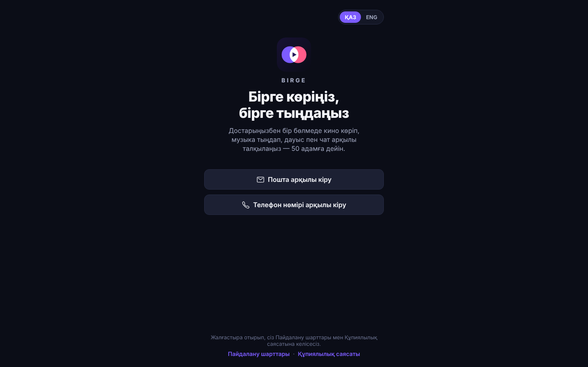
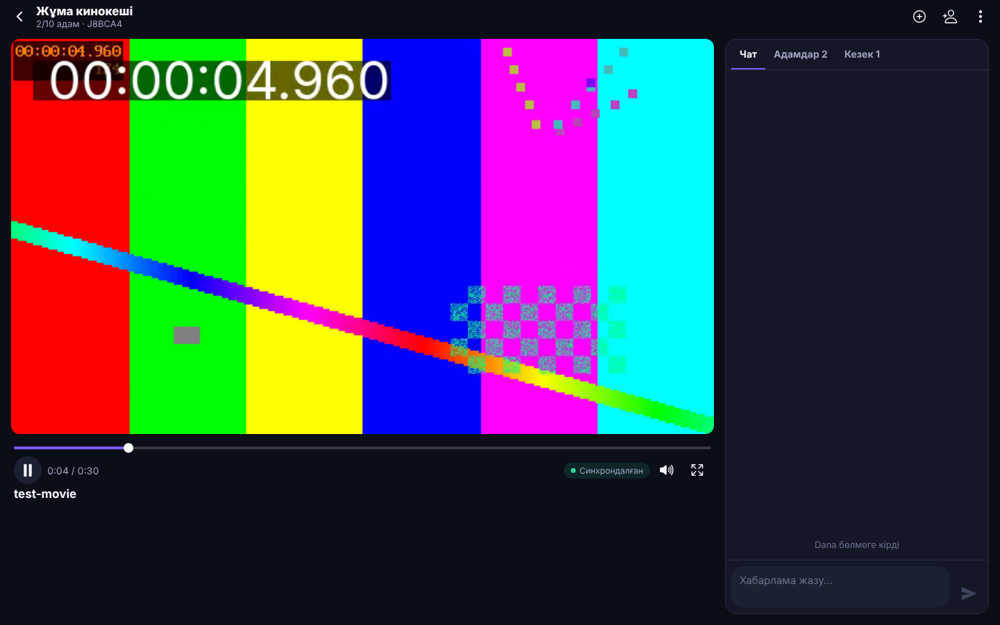
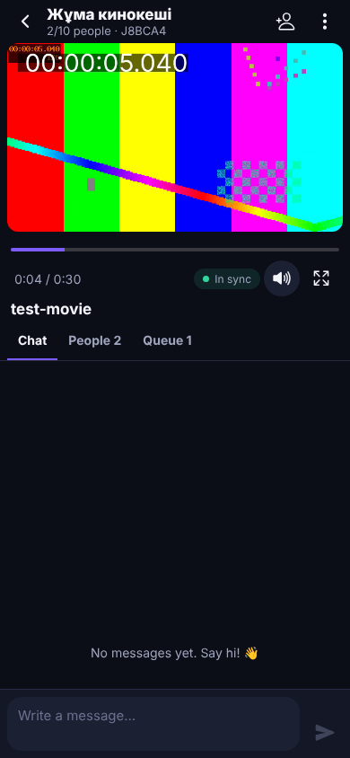
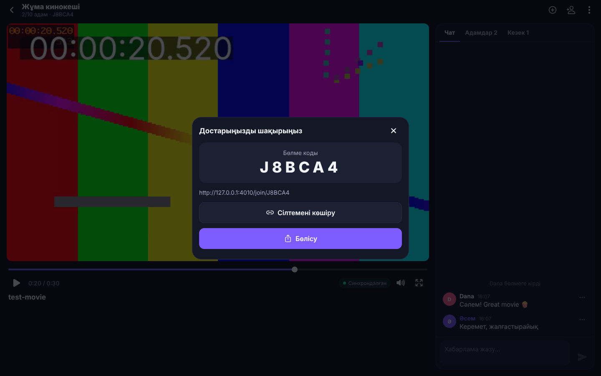
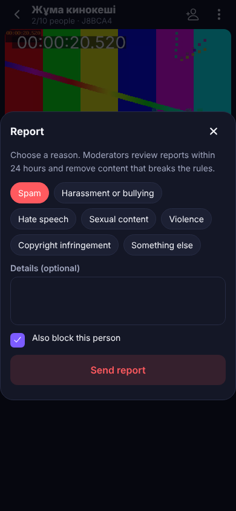
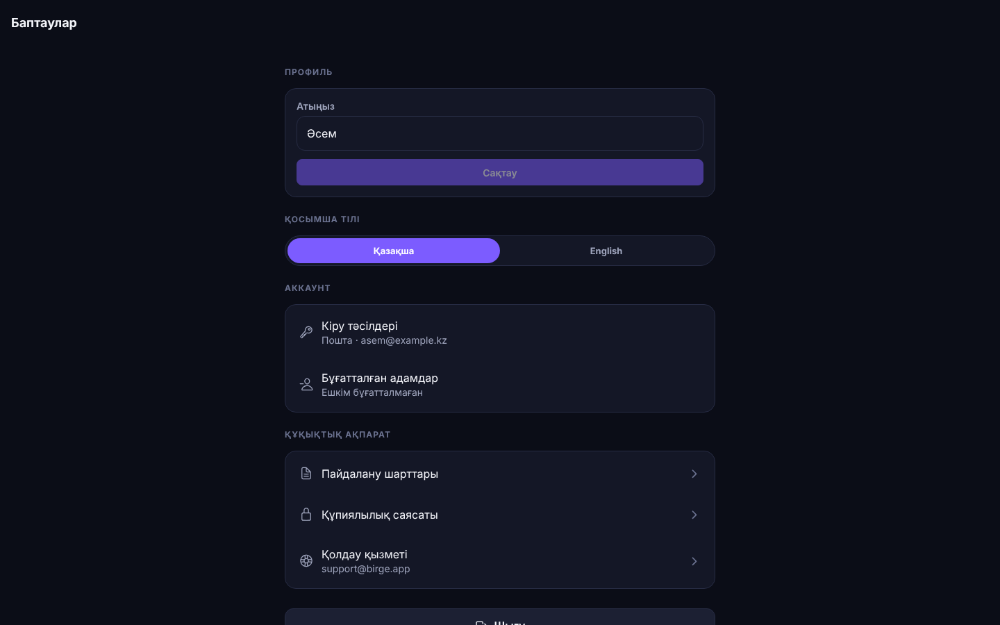

# 🎬 Birge — бірге көретін онлайн-кинотеатр

Достарыңызбен бір «бөлмеде» (серверде) кино көріп, музыка тыңдап, сол сәтте микрофон немесе чат арқылы талқылауға арналған қосымша.
Бөлмеге **2-ден 50-ге дейін** адам кіре алады. Бір код базасынан үш нұсқа шығады: **iOS**, **Android** және компьютерге арналған **веб-нұсқа** (Windows, macOS, Linux браузерлері).
Интерфейс тілі — тек **қазақша** және **ағылшынша**.

| Кіру (веб, қазақша) | Бөлме (ноутбук, қазақша) | Бөлме (телефон, ағылшынша) |
|---|---|---|
|  |  |  |

| Шақыру | Шағым жіберу | Баптаулар |
|---|---|---|
|  |  |  |

## Мүмкіндіктер

- **Бөлмелер (серверлер).** Кез келген адам бөлме ашып, сыйымдылығын 2–50 аралығында таңдайды. Достар 6 таңбалы код немесе
  `https://<домен>/join/КОД` сілтемесі арқылы қосылады. 50-ден асып кетпеуі серверде транзакция ішінде тексеріледі.
- **Кино мен музыка қосу** (тек бөлме иесі мен әкімшілері):
  - **Сілтеме** — YouTube (ресми ендірілген ойнатқыш) немесе бейне/аудио файлға тікелей сілтеме: `.mp4 .webm .mov .m3u8 (HLS) .mp3 .m4a .wav .flac …`;
  - **Файл** — өз құрылғысынан бейне не аудио жүктеу (бөлме мүшелеріне ғана қолжетімді, бөлме жабылғанда өшіріледі);
  - **Браузер** — компьютердегі веб-нұсқадан кез келген сайттың қойындысын **дыбысымен** бөлісу (Chrome/Edge/Firefox/Safari).
- **Синхронды ойнату.** Сервер — бірден-бір «шындық көзі». Әр құрылғы сервер сағатымен (NTP тәрізді) теңестіріліп, кішкене
  алшақтықты ойнату жылдамдығын ±5% өзгерту арқылы, үлкенін секіру арқылы түзетеді. Сынақта ноутбук пен телефонның
  айырмашылығы **0,01–0,02 секунд** болды. Ойнату/кідірту/айналдыру/келесіге өтуді тек әкімшілер басқарады.
- **Дауыстық чат** — LiveKit (WebRTC SFU), 50 адамға дейін. Микрофон тек қолданушы өзі қосқанда іске қосылады;
  кім сөйлеп тұрғаны көрінеді; әкімші біреудің микрофонын өшіре алады.
- **Мәтіндік чат** — балағат сөз сүзгісі (қазақ, орыс, ағылшын), спамға қарсы шектеу, хабарламаны өшіру.
- **Рөлдер мен модерация.** Иесі → әкімші → мүше. Әкімші тағайындау, бөлмеден шығару, бұғаттау. Әр қолданушы кез келген
  адамды бұғаттай (хабарламасы көрінбейді, дауысы естілмейді) және шағым жібере алады; модераторларға арналған бет бар.
- **Тіркелу:** Apple ID, Google аккаунт, электрондық пошта немесе телефон нөмірі (6 таңбалы бір реттік код, құпиясөзсіз).
- **Екі тіл.** Алғашқы ашқанда құрылғы тілі ағылшынша болса — English, қалған жағдайда — қазақша. Кез келген уақытта
  ауыстыруға болады (кіру бетінде және баптауларда); iOS/Android жүйелік баптауларындағы «қосымша тілі» де тек осы екеуін ұсынады.
- **App Store мен Google Play ережелеріне сәйкестік** — толық кесте: [docs/store-compliance.md](docs/store-compliance.md).

## Архитектура

```
birge/
├── apps/app         Expo SDK 58 (React Native 0.88) — iOS, Android, Web; Expo Router
├── apps/server      Node.js: Fastify (REST) + Socket.IO (нақты уақыт) + Postgres / PGlite
├── packages/shared  Ортақ типтер, шектеулер (2–50), синхрондау алгоритмі, сілтемелерді талдау
├── deploy/          LiveKit және Caddy (HTTPS) баптаулары
├── e2e/             Playwright: екі адам тіркеліп, бірге көріп, чатта сөйлесетін толық сценарий
└── docs/            Дүкендер талаптары, скриншоттар
```

- **Сервер** бөлменің күйін сақтайды: кім онлайн, кезек, не ойнап тұр (`{itemId, status, position, updatedAt, seq}`).
  Әкімшінің әр әрекеті күйді өзгертіп, бөлмедегілердің бәріне таратылады.
- **Дерекқор:** `DATABASE_URL` берілсе — PostgreSQL, берілмесе — ендірілген PGlite (Postgres-тің WebAssembly нұсқасы,
  `data/db` қалтасында). Яғни әзірлеу кезінде ештеңе орнатудың қажеті жоқ.
- **Дауыс пен экран бөлісу** LiveKit арқылы жүреді; сервер тек рөлге сай рұқсаты бар токен береді
  (мүше — тек микрофон, әкімші — микрофон + экран + экран дыбысы).
- **Веб-нұсқа** — сол Expo кодынан `expo export` арқылы жиналады және сервердің өзі таратады (бір домен, бір контейнер).

### «Браузер арқылы кез келген кино» туралы

Қосымшаның ішіне басқа сайттардан бейнені «суырып алатын» браузер салынбады: бұл App Store-тың 5.2.2/5.2.3 және
Google Play-дің зияткерлік меншік ережелерін бұзады да, қосымша тексеруден өтпейді. Оның орнына заңды үш жол бар:
YouTube-тың ресми ойнатқышы, тікелей файл сілтемесі/жүктеу және **компьютердегі браузер қойындысын бөлісу** —
әкімші кез келген сайтты өз браузерінде ашып, қойындыны дыбысымен бөліседі, ал қалғандары (телефонда да) көреді.
DRM-мен қорғалған сервистер (Netflix т.б.) бөлісуде қара экран береді — бұл браузердің қорғанысы.

## Жылдам бастау (әзірлеу)

Керек: **Node.js 20.19+** (22 ұсынылады), npm.

```bash
cd birge
npm install

# 1-терминал: сервер (http://localhost:4000). DEV_OTP=1 — кіру коды экранда және журналда көрсетіледі.
DEV_OTP=1 npm run dev:server

# 2-терминал: қосымша. «w» — веб, «i» — iOS, «a» — Android
npm run dev:app
```

Дауыстық чатты жергілікті тексеру үшін LiveKit-ті dev режимінде іске қосыңыз:

```bash
docker run --rm -p 7880:7880 -p 7881:7881 -p 7882:7882/udp livekit/livekit-server --dev --bind 0.0.0.0
DEV_OTP=1 LIVEKIT_URL=ws://localhost:7880 LIVEKIT_API_KEY=devkey LIVEKIT_API_SECRET=secret npm run dev:server
```

> **Маңызды:** дауыстық чат нативті WebRTC модульдерін қолданады, сондықтан телефонда **Expo Go жұмыс істемейді** —
> development build керек: `cd apps/app && npx expo run:ios` / `npx expo run:android` немесе
> `npx eas-cli@latest build --profile development`.

## Тесттер

```bash
npm test             # ортақ логика + сервер: тіркелу, OAuth, 50 адам шегі, синхрондау, чат, файлдар, модерация (46 тест)
npm run typecheck    # TypeScript: shared, server, app (iOS/Android/Web файлдарымен)
npm run build:web && npm run build:server && npm run e2e   # Playwright: толық сценарий екі браузерде
```

E2E сценарийі: екі адам (біреуі ноутбукта қазақша, екіншісі телефонда ағылшынша) пошта мен телефон арқылы тіркеледі →
бөлме ашылады → код арқылы қосылады → иесі фильм жүктейді → бірге ойнатады (айырма тексеріледі) → айналдырады →
чатта жазысады → мүше ойнатуды басқара алмайтыны тексеріледі → шақыру сілтемесімен үшінші адам тіркеліп кіреді →
тіл ауыстырылады → аккаунт жойылады. Скриншоттар `e2e/artifacts/` қалтасына сақталады.

## Серверге орнату (продакшн)

Бір VPS жеткілікті (2 vCPU / 4 GB RAM ~50 адамдық бірнеше бөлмеге). **Қазақстан азаматтарының дербес деректері
ҚР аумағындағы серверде сақталуы керек** (ҚР «Дербес деректер және оларды қорғау туралы» Заңы) — хостингті соған сай таңдаңыз.

```bash
cp .env.example .env        # домендер, SECRET, SMTP, SMS, Google, Apple, LiveKit кілттерін толтырыңыз
docker compose up -d --build
```

Құрамы: `app` (сервер + веб-нұсқа), `postgres`, `livekit`, `caddy` (Let's Encrypt арқылы HTTPS).
DNS: `APP_DOMAIN` және `LIVEKIT_DOMAIN` сервер IP-іне. Firewall-да ашу керек порттар:
`80, 443/tcp`, `7881/tcp`, `3478/udp` (TURN), `50000–60000/udp` (WebRTC).

### Кіру тәсілдерін баптау

| Тәсіл | Не керек | Айнымалылар |
|---|---|---|
| Пошта | Кез келген SMTP (мыс. Amazon SES, Mailgun, Yandex 360) | `SMTP_URL`, `MAIL_FROM` |
| Телефон | Twilio (Қазақстанға SMS жібереді) | `SMS_PROVIDER=twilio`, `TWILIO_*` |
| Google | Google Cloud Console → OAuth client (Web). Redirect URI: `https://<домен>/api/auth/oauth/google/callback` | `GOOGLE_CLIENT_ID`, `GOOGLE_CLIENT_SECRET` |
| Apple | developer.apple.com: App ID-де «Sign in with Apple», Services ID (веб/Android), .p8 кілт. Return URL: `https://<домен>/api/auth/oauth/apple/callback` | `APPLE_TEAM_ID`, `APPLE_KEY_ID`, `APPLE_PRIVATE_KEY`, `APPLE_BUNDLE_ID`, `APPLE_SERVICES_ID` |

Қосымша тек серверде бапталған тәсілдердің батырмаларын көрсетеді. iOS-та Google батырмасы Sign in with Apple
бапталған кезде ғана шығады (App Store 4.8 талабы). Apple арқылы кірген қолданушы аккаунтын жойғанда, сервер
Apple токендерін `auth/revoke` арқылы қайтарып алады (Apple талабы).

Басқа маңызды айнымалылар: `SECRET` (міндетті, ≥32 таңба), `WEB_URL`, `SUPPORT_EMAIL`, `MODERATOR_EMAILS`
(шағымдарды қарайтындар), `REVIEW_LOGINS` (App Review үшін тұрақты код), `MAX_UPLOAD_MB`, `ANDROID_CERT_SHA256`
(шақыру сілтемесі Android қосымшасын тікелей ашуы үшін). Толық тізім — [.env.example](.env.example).

## Мобильді қосымшаны дүкендерге шығару

1. **Аккаунттар:** Apple Developer Program және Google Play Console.
2. **Идентификаторлар:** [apps/app/eas.json](apps/app/eas.json) ішінде `BIRGE_IOS_BUNDLE_ID`, `BIRGE_ANDROID_PACKAGE`,
   `BIRGE_DOMAIN`, `EXPO_PUBLIC_API_URL`, `EXPO_PUBLIC_OPERATOR_NAME` мәндерін өзіңіздікіне ауыстырыңыз.
3. **Құрастыру және жіберу** (Mac қажет емес — EAS бұлтта жинайды):
   ```bash
   cd apps/app
   npx eas-cli@latest init
   npx eas-cli@latest build --platform all --profile production
   npx eas-cli@latest submit --platform ios
   npx eas-cli@latest submit --platform android
   ```
4. **Дүкен беттері:** атауы, сипаттамасы, скриншоттар — қазақша және ағылшынша. Privacy Policy URL:
   `https://<домен>/privacy`, Terms: `https://<домен>/terms`, аккаунтты жою: `https://<домен>/delete-account`.
5. **Тексерушілерге арналған жазба** (App Review Notes / Play «App access»): `REVIEW_LOGINS` арқылы берілген пошта мен
   6 таңбалы код, сондай-ақ сынақ бөлмесінің коды. Үлгі мәтін — [docs/store-compliance.md](docs/store-compliance.md).
6. Жариялау алдында [Пайдалану шарттары мен Құпиялылық саясатын](apps/app/src/legal/content.ts) заңгерге көрсетіп,
   ұйым атауын (`EXPO_PUBLIC_OPERATOR_NAME`) нақтылаңыз.

## Белгілі шектеулер

- Экранды/қойындыны бөлу тек компьютердегі браузерден (iOS-тағы ReplayKit broadcast extension әзірге жоқ). Телефондағылар бөлісуді көре алады.
- YouTube ойнатқышы тек бекітілген жылдамдықтарды қолдайды, сондықтан YouTube-та синхрондау секіру арқылы ғана (±1,5 с).
- Бұл ортада Xcode/Android SDK жоқ: нативті бандлдар (`expo export --platform ios/android`) және `expo prebuild` нәтижесі
  (рұқсаттар, Info.plist, тілдер) тексерілді, бірақ нақты құрылғыда development build арқылы сынап көру керек.
- Жүктелген файлдар сервер дискісінде сақталады; көп қолданушы болса, оларды S3 сияқты сақтауға көшіруге болады.

---

## English summary

Birge is a watch-party app for iOS, Android and the web: create a room for 2–50 people, add a YouTube link, a direct
video/audio link (incl. HLS) or upload a file — or share a browser tab with sound from the desktop web app — and everyone
watches in sync while talking over voice (LiveKit SFU) and text chat. Sign in with Apple, Google, email or phone (one-time
codes). The UI is available in Kazakh and English only. Stack: Expo SDK 58 / React Native 0.88 (one codebase for all
platforms), Fastify + Socket.IO, PostgreSQL (or embedded PGlite), LiveKit. Store-compliance features (Sign in with Apple,
in-app and web account deletion with Apple token revocation, UGC reporting/blocking/filtering, EULA acceptance, privacy
manifest, minimal permissions) are documented in [docs/store-compliance.md](docs/store-compliance.md).
Run `npm install`, `DEV_OTP=1 npm run dev:server` and `npm run dev:app` to start developing; `docker compose up -d --build` to deploy.
