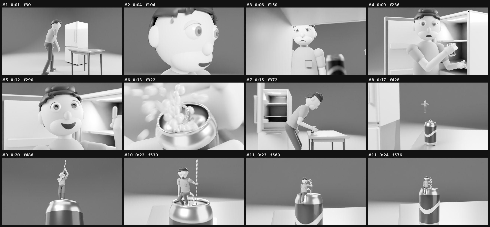

# «Шөлдеген адам» — Blender референс видео

Шөлдеп келген адам тоңазытқышты ашады. Ішінде жалғыз банка сусын бар. Ол банканы қолына алып, «бұл аз ғой» дегендей сөйлейді. Сосын оған идея келеді: банканы «пыс» еткізіп ашады да, үстелге қояды. Үстіне секірген сәтте өзі кішірейіп, банканың үстіне қонады. Енді банка алып, ал ол кішкентай. Қалтасынан ұзын түтікше суырып алып, банканың шетінде отырып ішеді.

| Параметр | Мәні |
|---|---|
| Ұзақтығы | 24 секунд (576 кадр, 24 fps) |
| Форматы | 16:9, 1920×1080 (Cycles-та 1280×720-мен рендерленіп, ffmpeg арқылы үлкейтілген) |
| Стилі | Түссіз, монохром «саз» (clay) стилі. Фон — біркелкі тегіс студия (циклорама) |
| Камера | 11 ракурс: ілесе жүру, ірі план, тоңазытқыштың ішінен түсірілген кадр, макро, кран, төменгі ракурс. Тереңдік (DOF), фокусты ауыстыру, қозғалыс бұлдырлығы және «қолдағы камера» дірілі қосылған |
| Дыбыс | Синтезделген эффекттер (қадам, ентігу, есік, «динь», «пыс», ысқыру, сору) және жеңіл музыка. Дауыс жоқ |



## Кадрлар мен таймлайн

| # | Кадр | Уақыт | Ракурс / камера | Не болады |
|---|---|---|---|---|
| 1 | 1–63 | 0:00–2.6 | Кең план, төменнен, бүйірден ілесе жүретін камера (24 мм) | Шөлдеген адам тоңазытқышқа әрең жетеді: еңкейіп, басы салбырап, аузы ашық, ентігіп келеді |
| 2 | 64–107 | 2.6–4.5 | Ірі план, баяу жақындау (32 мм) | Маңдайынан тер ағады. Білегімен сүртіп, терді сілкиді, тоңазытқышқа үмітпен қарайды |
| 3 | 108–175 | 4.5–7.3 | Тоңазытқыштың ішінен (POV), фокус банкадан бетке ауысады (26 мм, f/2) | Есік ашылып, ішкі жарық бетіне түседі. Алдымен қуанады, бірақ ішінде жалғыз банка ғана тұр — көңілі түседі. Жақындап, банканы алады |
| 4 | 176–261 | 7.3–10.9 | Орта план, баяу айналу (40 мм) | Үстелге бұрылады. Банканы ұстап, «Бұл... аз ғой!» дегендей сөйлейді (ерні қозғалады), басын шайқап, қолын жайып «осы ма?» дейді |
| 5 | 262–311 | 10.9–13.0 | Бетке жақындау, 42→50 мм | Иегін ұстап ойланады. Кенет идея келеді: көзі бақырайып, күлімсірейді, сұқ саусағын көтереді. Сосын қулана күледі |
| 6 | 312–337 | 13.0–14.0 | Макро (90 мм) | Саусағымен қақпақты көтереді — «пыс!». Көбік шашырап, тесік ашылады. Рахаттанып көзін жұмады |
| 7 | 338–391 | 14.0–16.3 | Бүйірден, үстел биіктігінде (26 мм) | Үстелге екі қадам басып, банканы қояды. Артта тоңазытқыш есігі жабылады. Секіруге отырады |
| 8 | 392–445 | 16.3–18.5 | Кран + зум (24→58 мм) | Секіріп, ауада бұрылады да кішірейіп, ашық банканың үстіне қонады. Тепе-теңдігін әрең сақтайды |
| 9 | 446–505 | 18.5–21.0 | Үстел деңгейінен төменгі ракурс (30 мм) | Банка енді алып. Таңырқап жан-жағына қарайды. Төс қалтасынан түтікше суыра бастайды, ол таусылмай кадрдан асып кетеді |
| 10 | 506–539 | 21.0–22.5 | Орта план, айналу (30 мм) | Түтікшені тесікке тығып, банканың шетіне аяғын салбыратып отырады |
| 11 | 540–576 | 22.5–24.0 | Кейін шегініп, жоғары көтерілу (40→36 мм) | Түтікшенің ұшын аузына иіп, көзін жұмып рахаттанып ішеді, аяғын тербетеді |

Ерін қозғалысы: «Бұл... аз ғой!» — 222–261-кадр. Қолмен ишара — 232–256-кадр.

## Файлдар

| Файл | Не үшін |
|---|---|
| `shol-reference.mp4` | Дайын видео (1080p, дыбысымен) |
| `shol.blend` | Blender 5.2 сахнасы: модельдер, риг, анимация, 11 камера, жарық, рендер баптаулары |
| `scene.py` | Бүкіл сахнаны нөлден құратын скрипт (модель, риг, анимация, камералар) |
| `render.py` | Кадрларды PNG етіп рендерлейді. Үзіліп қалса, сол жерінен жалғастырады |
| `sound.py` | Дыбыс жолын синтездейді (`numpy`) |
| `make_video.sh` | Кадрлар мен дыбысты 1080p MP4-ке жинайды (виньетка, жеңіл түйіршік, fade) |
| `storyboard.jpg` | Әр кадрдан бір сурет |

## Қалай қайта жасауға болады

Blender 5.x (немесе `pip install bpy==5.2.3`, Python 3.13) және `ffmpeg` керек.

```bash
# 1) сахнаны құру (≈5 с)
blender -b -P scene.py -- --save shol.blend          # немесе: python scene.py --save shol.blend
# 2) кадрларды рендерлеу (Cycles CPU, 4 ядрода ≈11–25 с/кадр)
blender -b shol.blend -P render.py -- --out frames   # немесе: python render.py --blend shol.blend --out frames
#    тек бір бөлігін: --frames 300-340   тез алдын ала көру: --res 480x270 --samples 4
# 3) дыбыс және видео
python sound.py soundtrack.wav
./make_video.sh frames soundtrack.wav shol-reference.mp4
```

Blender интерфейсінде: `shol.blend` файлын ашыңыз. Камералар Timeline-дағы маркерлер арқылы ауысады. Рендерлеу үшін Render → Render Animation (Ctrl+F12) басыңыз.

## Өзгерту

- **Уақыт пен әрекет** — `scene.py` ішіндегі `act_body`, `act_arms`, `act_can_and_after`, `act_gestures`, `act_tiny` функциялары. Кадр нөмірлері кодта тікелей жазылған. Негізгі сәттер `TT` сөздігінде (банканы алу — 176, «пыс» — 320, банканы қою — 370, секіру — 398, қону — 430).
- **Бет-әлпет** — `EX` сөздігі (қас, қабақ, көз, ауыз пішіндері) және `act_face`. Ауыздың пішін кілттері: `open`, `smile`, `frown`, `O`, `wide`, `side`.
- **Камералар** — `build_cameras()`: әр кадрдың басталатын кадры, объективі, f-stop мәні және қозғалыс жолы.
- **Кішірею** — `K_TINY = 0.035`. Кейіпкер банканың үстінде бастапқы бойының 3,5%-ы болады (≈6 см).
- **Түс** — барлық материал сұр реңкте (`build_materials`). Түс қажет болса, `material(...)` ішіндегі мәндерді RGB-ге ауыстырыңыз. `make_video.sh` ішіндегі `hue=s=0` сүзгісін де алып тастау керек.

## Кейіпкер ригі

Арматура IK-мен жасалған: қолдар мен аяқтардың нысана сүйектері бар (`ik_hand.*`, `ik_foot.*`, `pole_*`). Дене бөліктері сүйектерге қатты бекітілген, яғни «қуыршақ/мульт» стилі. Бетте мыналар бар:

- көз алмасы (қарашығы бұрылады) және жоғарғы қабақ (жыпылықтайды, шаршағанда жартылай жабылады);
- қас (көтеріледі, қисаяды);
- ауыз (пішін кілттері арқылы);
- тіл және тер тамшылары.

Сусын банкасы мен түтікше қолдың позициясынан кадр сайын «пісірілген» (baked).
