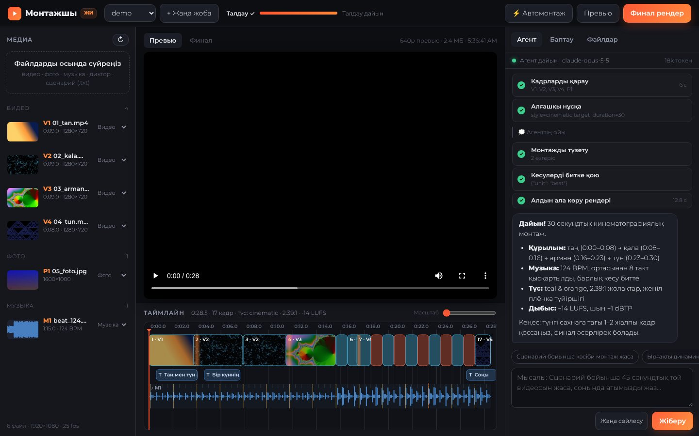
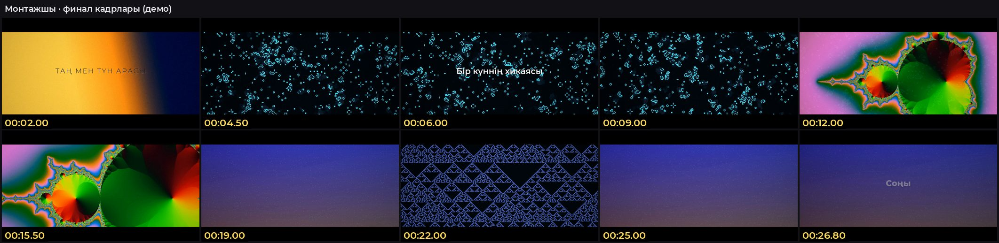

# 🎬 Монтажшы — кәсіби видеомонтаж жасайтын ЖИ агенті

Дайын материалды (видео, фото, музыка, диктор, дыбыс эффектілері) және сценарийді бересіз —
Монтажшы оны **кәсіби монтажшы сияқты** жинайды: кадрларды көріп, сценарий бойынша ретке қояды,
музыканы талдап, кесулерді битке дәл түсіреді, дыбысты тазартып, музыканы сөз астында басады,
түсті біркелкі етеді, ауысулар мен титрлер қосады, өз жұмысын тексеріп, түзетеді. Нәтиже —
дайын MP4 және Premiere Pro / DaVinci Resolve-та жалғастыруға болатын жоба файлдары.



## Не істей алады

| Сала | Мүмкіндік |
|---|---|
| 👁 **Көру** | ЖИ әр файлды контакт-парақтар (уақыт белгісі бар кадрлар торы) арқылы «көреді»: не түсірілгенін, қай кадр айқын, қайсысы бұлыңғыр екенін өзі анықтайды |
| 📜 **Сценарий** | Сахналарды мағынасы бойынша кадрларға сәйкестендіреді. Файл аттары латынша болса да (`kala.mp4` = «Қала») танылады. `[файл.mp4]`, `@V3`, `Титр:` белгілері |
| 🎵 **Музыка** | BPM, әр бит, такт басы (downbeat), бөлімдер (тыныш/қарқынды), «дроп» сәттері. Бит дәлдігі ±10 мс |
| ✂️ **Ырғақ** | Кесулер битке/тактке кадрға дейін дәл түседі; тыныш бөлімде ұзын кадрлар, қарқынды бөлімде жылдам; ең күшті кадр — дропта |
| 🎼 **Музыкалық монтаж** | Әнді видео ұзақтығына келтірудің кәсіби тәсілдері: ортасынан бүтін тактілерді алып тастау (жапсар такт басында), **backtime** (ән табиғи аяқталуы соңғы кадрмен дәл келеді), қайталау, сөндіру |
| 🔊 **Дыбыс** | Диалогты тазарту (шу азайту, EQ, де-эссер, компрессор), барлық диалогты бір қаттылыққа теңестіру, **J/L-кесулер**, тең қуатты кроссфейдтер, «шырт» дыбыссыз микро-кроссфейдтер |
| 🎚 **Ducking** | Диктор/диалог кезінде музыка өзі басылады — және сөз басталмай тұрып (look-ahead 0,2 с) төмендейді, нақты уақыттағы компрессорлар мұны істей алмайды |
| 📏 **Қаттылық стандарты** | Екі өтімді EBU R128: YouTube/Instagram/TikTok −14 LUFS, ТВ −23 LUFS, шың −1 dBTP. Қажет болса мастер-лимитер |
| 🎨 **Түс** | 9 пресет (кинематографиялық teal & orange, жылы, салқын, драма, жарқын, ақ-қара, винтаж, той, табиғи), кадрлар арасындағы жарық пен ақ балансын автотеңестіру, 2.39:1 жолақтар, плёнка түйіршігі, виньетка |
| 🔀 **Ауысулар** | Тікелей кесу (негізгі), араласу, қараға/аққа батыру, жарқыл, whip, slide, zoom, iris… — стильге сай, орынды жерде ғана |
| 🖼 **Кадрлау** | 16:9, 9:16, 1:1, 4:5 — тік видеоны көлденең кадрға бұлдыр фонмен сыйғызу, фотоларға Ken Burns қозғалысы, статикалық кадрларға баяу push-in |
| 🔤 **Титрлер** | Кинематографиялық, ортадағы, lower third (есім/қызмет), субтитр, тарау, соңғы карточка. Қазақ әріптерін толық қолдайтын Montserrat қарпі. Мәтін түсі фонның жарықтығына қарай өзі таңдалады |
| 🔍 **Өзін тексеру** | Агент өз рендерін көріп шығады (QC-парақ), қате тапса — түзетіп, қайта рендерлейді |
| 📤 **Экспорт** | `final.mp4` (H.264, 1080p), Premiere/DaVinci үшін **FCP7 XML**, **CMX3600 EDL**, **SRT**, дыбыс **стемдері** (диалог/музыка/эффектілер) |
| ⚡ **ЖИ-сыз режим** | API кілті болмаса да «Автомонтаж» жұмыс істейді: сценарий реті, бит бойынша кесу, стиль, музыка, түс, дыбыс — бәрі бар |



## Қалай жұмыс істейді

```
материал + сценарий
      │
      ▼
 ТАЛДАУ (numpy + FFmpeg) ── кесінділер, айқындық, қозғалыс, жарық, түс
      │                     сөйлеу (VAD), қаттылық (LUFS)
      │                     музыка: BPM, бит, такт, бөлімдер, дроп
      ▼
 ЖИ АГЕНТ (Claude) ──────── кадрларды көреді → сценарийге сәйкестендіреді →
      │                     таймлайн жазады → битке тураланады → превью →
      │                     өз рендерін тексереді → түзетеді → финал
      ▼
 РЕНДЕР (FFmpeg) ────────── әр кадр: кадрлау, қозғалыс, түс (кэшпен)
      │                     жинау: xfade ауысулар, жолақтар, титрлер
      │                     дыбыс: шиналар, ducking, loudnorm (2 өтім)
      ▼
 final.mp4 · Premiere/DaVinci XML · EDL · SRT · стемдер
```

Монтаж толығымен `timeline.json` файлында сипатталады (EDL). Оны агент те, автомонтаж да, сіз де өзгерте аласыз — рендер тек осы файлды оқиды. Түзетулер кезінде тек өзгерген кадрлар қайта рендерленеді.

## Орнату

Керек: **Python 3.10+** және **FFmpeg 5.1+**.

### Linux / macOS — бір команда

```bash
curl -fsSL https://raw.githubusercontent.com/bexu-higgs/motion-project/main/montazhshy/install.sh | bash
```

Скрипт кодты `~/montazhshy` қалтасына жүктейді, кітапханаларды орнатады және баптау шеберін ашады
(FFmpeg тексеру, API кілті, сынақ жобасы). FFmpeg: Ubuntu — `sudo apt install ffmpeg`, macOS — `brew install ffmpeg`.

### Windows

1. Python: https://www.python.org/downloads/ («Add python.exe to PATH» белгісін қойыңыз).
2. FFmpeg: PowerShell-де `winget install --id Gyan.FFmpeg -e`, сосын терминалды қайта ашыңыз.
3. PowerShell-ге кезекпен:

```powershell
cd $HOME
curl.exe -L -o mz.zip https://codeload.github.com/bexu-higgs/motion-project/zip/refs/heads/main
tar -xf mz.zip
cd motion-project-main\montazhshy
python -m venv .venv
.venv\Scripts\python -m pip install -r requirements.txt
.venv\Scripts\python -m montazhshy setup
```

Кейін Студияны `start.bat` файлын екі рет басып ашасыз.

### API кілті

ЖИ агенті Anthropic Claude моделін қолданады (әдепкі: `claude-opus-5-5`). Кілтті
[console.anthropic.com](https://console.anthropic.com) → API Keys бөлімінен алып, баптау шеберіне немесе
Студиядағы «Баптау» бөліміне енгізіңіз. Кілт тек сіздің компьютеріңізде, `montazhshy/.env` файлында сақталады.
Кілтсіз де «⚡ Автомонтаж» толық жұмыс істейді.

## Қолдану

### 1. Студия (ұсынылады)

```bash
./start.sh            # Windows: start.bat
```

Браузерде `http://127.0.0.1:8765` ашылады (тек сіздің компьютеріңізде).

1. Сол жаққа видео, фото, музыка, диктор файлдарын сүйреңіз (немесе жоба қалтасына көшіріңіз).
   Файлдар бірден талданады: кесінділер, бит, сөйлеу.
2. «Баптау»: сценарий, стиль, формат (16:9 / 9:16 / …), платформа, ұзақтық.
3. «Агент» бөлімінде тапсырма жазыңыз, мысалы:
   - *«Сценарий бойынша 60 секундтық той видеосын жаса, соңында «Айдана & Ерлан» деп жаз»*
   - *«Instagram Reels үшін 25 секундтық динамикалық нұсқа, дропта ең әсерлі кадр»*
   - *«Сұхбатты сценарийдегі ретпен жина, J-кесулер қолдан, музыка фонда»*
4. Агенттің әр қадамын көресіз (кадрларды қарау, монтаж, рендер, тексеру). Нәтиже плеерде ашылады,
   таймлайнда кадрлар, ауысулар, титрлер, музыка толқыны, биттер мен такт сызықтары көрінеді.
5. Түзету сұраңыз: *«2-сахнаны қысқарт»*, *«түсін жылырақ ет»*, *«музыканы сөз астында тағы басыңқы қой»*.
6. «Финал рендер» → `renders/final.mp4` + `exports/` (Premiere/DaVinci XML, EDL, SRT). «Файлдар» бөлімінен жүктеп аласыз.

### 2. Терминалда

```bash
# ЖИ агенті (соңында түзету сұрайды)
./start.sh agent ~/Videos/toi "45 секундтық кинематографиялық той видеосы" --style wedding --platform instagram

# ЖИ-сыз автомонтаж + финал
./start.sh auto ~/Videos/sayahat --style vlog --aspect 9:16 --duration 30 --final

# Басқа командалар
./start.sh analyze ~/Videos/toi        # не табылғанын көру (BPM, кесінділер, сөйлеу)
./start.sh render  ~/Videos/toi --final --stems
./start.sh export  ~/Videos/toi        # Premiere/DaVinci XML, EDL, SRT
./start.sh demo                         # сынақ жобасы (синтетикалық видео + 124 BPM музыка)
```

### Жоба қалтасы

```
менің_жобам/
├── 01_tan.mp4, 02_kala.mov, …   ← видео (кез келген атау, ішкі қалталар да болады)
├── photo.jpg                     ← фото (Ken Burns қозғалысымен)
├── music/song.mp3                ← музыка («music», «музыка», «ән» қалтасы/атауы)
├── diktor.wav                    ← диктор («диктор», «voice», «vo_» атауы)
├── sfx/whoosh.wav                ← эффектілер («sfx», «whoosh»)
├── scenariy.txt                  ← сценарий (міндетті емес)
├── timeline.json                 ← монтаж (агент жазады; қолмен де өзгертуге болады)
├── renders/preview.mp4, final.mp4
└── exports/montazh_premiere_resolve.xml, montazh.edl, titrler.srt, stems/
```

Рөлі қате анықталса, Студияда файлдың жанындағы тізімнен ауыстырыңыз.

### Сценарий пішімі

```
# Таң мен түн арасы
1. Таң атады. Аспан түсін өзгертеді. [01_tan.mp4]
Титр: Бір күннің хикаясы

2. Қала оянады — тіршілік, қозғалыс, ырғақ. @V2
Диктор: «Бұл қала ешқашан ұйықтамайды»

3. Түн. Жұлдыздар мен тыныштық.
```

- Сахналар нөмірмен (`1.`, `Сахна 2`) немесе бос жолмен бөлінеді.
- `[файл.mp4]` немесе `@V3` — бұл сахнаға нақты осы кадр.
- `Титр:` — экрандағы жазу, `Диктор:` — агентке арналған ескертпе.
- Сілтеме болмаса, ЖИ агенті кадрлардың **мазмұнына** қарап, ал автомонтаж файл атауына қарап сәйкестендіреді.

## Стильдер

| Стиль | Сипаты |
|---|---|
| Кинематографиялық | Такт басында кесу, жұмсақ ауысулар, teal & orange, 2.39:1, түйіршік |
| Динамикалық (Reels/TikTok) | 1–2 битте кесу, дропта жарқыл/whip, жарқын түс |
| Деректі фильм | Сөйлеуді кеспейді, J/L-кесулер, табиғи түс, музыка фонда, backtime |
| Той / Үйлену | Ұзын кадрлар, араласу, нәзік жылы түс |
| Трейлер | Шиеленіс өседі, қараға батыру, жарқыл-акценттер, ірі титрлер |
| Влог / Саяхат | Жеңіл ырғақ, кейде whip/slide, жылы түс |

## Техникалық мәліметтер

- **Талдау:** кесінді табу — түс гистограммасы + кадр айырмасы (кадрға дейін нақтыланады);
  айқындық — Лаплас дисперсиясы; бит — мел-спектр flux + автокорреляция + динамикалық бағдарламалау (Ellis 2007),
  бас жиіліктегі соққыларды ескереді; такт басы — 4 фазаның ең күштісі; бөлімдер — тактілер ұқсастық матрицасының «жаңалық» шыңдары.
- **ЖИ агенті:** Anthropic SDK, ағынмен (streaming), adaptive thinking, prompt caching, серверлік fallback.
  11 құрал: `project_overview`, `view_media` (суреттер), `music_grid`, `auto_draft`, `set_timeline`,
  `edit_timeline`, `fit_music`, `snap_to_beats`, `render_preview` (QC-парақ), `inspect_preview`, `render_final`.
  Модель мен ойлау деңгейін өзгерту: `.env` ішінде `MONTAZH_MODEL=…`, `MONTAZH_EFFORT=high|xhigh|max`.
- **Рендер:** әр кадр аралық файлға (кэш), сосын concat/xfade жинау. Фото мен статикалық кадрлардың
  қозғалысы `scale(eval=frame)` арқылы — дірілсіз. Финал: H.264 CRF 17, AAC 320k, 48 кГц, bt709.
- **Дыбыс:** numpy-дағы шиналар (диалог / табиғи дыбыс / музыка / эффектілер), FFmpeg-тегі өңдеу,
  EBU R128 екі өтімді нормалау.
- **Құпиялылық:** бәрі сіздің компьютеріңізде өңделеді. ЖИ агентіне тек кішірейтілген кадрлар
  (контакт-парақтар) мен талдау мәтіні жіберіледі; видео мен дыбыстың өзі ешқайда жүктелмейді.

## Шектеулер

- Сөйлеуді мәтінге айналдыру (транскрипция) жоқ: агент сөйлеудің қай жерде екенін біледі, бірақ не айтылғанын естімейді.
  Сұхбатты мағынасы бойынша кесу үшін сценарийге уақыт белгілерін жазыңыз.
- Тұрақтандыру (stabilization), бет-әлпетті бақылау, жылдамдықтың бір кадр ішінде өзгеруі (speed ramp) әзірге жоқ.
- Рендер жылдамдығы компьютерге байланысты: 1080p финал әдетте видео ұзақтығынан 1–3 есе ұзақ.

## Тесттер

```bash
.venv/bin/python -m pip install -r requirements-dev.txt
.venv/bin/python -m pytest -q
```

Тесттер синтетикалық медиамен (FFmpeg-пен жасалады) бит дәлдігін, сөйлеуді табуды, кесінділерді,
музыкалық монтажды, ducking-ті, кесулердің битке дәлдігін, рендер мен LUFS-ті, экспортты және
агенттің Claude API-ге жіберетін сұранысын (жергілікті жалған серверде) тексереді.

## Файлдар

```
montazhshy/
├── install.sh, start.sh, start.bat
├── montazhshy/
│   ├── cli.py              — командалар
│   ├── setup.py            — баптау шебері
│   ├── project.py          — жоба, медиа тізімі, талдау кэші
│   ├── analysis/           — shots.py (кадрлар), audio.py (сөйлеу, LUFS), beats.py (ырғақ)
│   ├── timeline.py         — монтаж моделі (EDL), кадрға дейін дәл орналастыру
│   ├── styles.py           — стильдер, түс пресеттері, платформалар
│   ├── script.py           — сценарийді талдау
│   ├── musicfit.py         — музыкалық монтаж (edit / backtime / loop / fade)
│   ├── autoedit.py         — ЖИ-сыз автомонтаж
│   ├── render/             — video.py, audio.py, renderer.py, qc.py
│   ├── export/nle.py       — FCP7 XML, EDL, SRT
│   ├── agent/              — Claude агенті: prompts.py, tools.py, agent.py
│   ├── studio/             — жергілікті веб-студия (server.py + static/)
│   └── fonts/              — Montserrat (SIL Open Font License)
└── tests/
```
