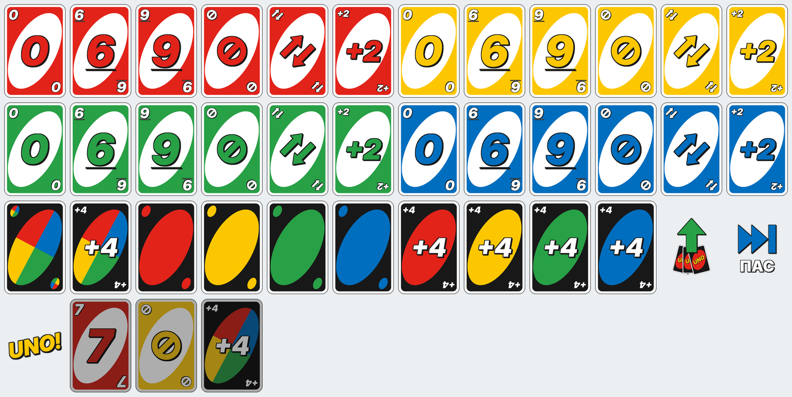

# 🃏 UNO боты — қазақ тілінде

Telegram топтарына арналған UNO ойынының боты. Ботты чатқа қосасыз — ойынды ол өзі жүргізеді:
карта таратады, кезекті бақылайды, ресми ережелердің бұзылмауын қадағалайды және орындарды анықтайды.
Әр картаның өз стикері бар.



## Мүмкіндіктер

- **Ресми Mattel ережелері толық**: 108 карта, 2–10 ойыншы, 7 картадан тарату, бастапқы картаның
  ерекше жағдайлары, Skip / Reverse / Draw Two / Wild / Wild Draw Four, Challenge, UNO айту және
  ұстау. Ойын бір рет ойналады: картасынан бірінші құтылған — 1-орын, екіншісі — 2-орын, тағы солай,
  бір ғана ойыншы қалғанша.
- **Әр картаның жеке стикері**: 54 карта беті, түсі таңдалған 8 Wild нұсқасы, ойнауға болмайтын
  карталардың күңгірт нұсқалары және карта пішінінде емес «карта алу» (жоғары стрелка), «ПАС», «UNO!»
  батырмалары — барлығы 119 стикер.
  Бот стикер жинақтарын өзі жасап, жүктейді.
- **Қазақ тілі**: барлық хабарламалар қазақша, ал негізгі терминдер (UNO, Wild, Wild Draw Four,
  Draw Two, Skip, Reverse, Challenge) түпнұсқа күйінде қалдырылған.
- **Inline режимі**: ойыншы `@бот_аты` деп жазғанда өз карталарын стикер ретінде көреді (оларды тек
  өзі көреді). Жүруге болатын карталар жарқын, болмайтындары күңгірт болып көрсетіледі (түсі көрініп тұрады).
- **Кезек таймері**: ойыншы уақытында жүрмесе, бот оның орнына карта алып, кезекті өткізеді;
  3 рет қатарынан жүрмеген ойыншы ойыннан шығарылады.

## Ережелер (қысқаша)

| Жағдай | Ереже |
|---|---|
| Жүріс | Түсі, саны немесе белгісі сәйкес келетін картамен; Wild — кез келген уақытта |
| Жүре алмасаң | 1 карта аласың; ол жарамды болса — сол картамен жүре аласың, болмаса кезек өтеді |
| Skip | Келесі ойыншы кезегін өткізеді |
| Reverse | Бағыт өзгереді (екі ойыншыда Skip сияқты) |
| Draw Two | Келесі ойыншы 2 карта алып, кезегін өткізеді (үстіне қосуға болмайды) |
| Wild | Келесі түсті таңдайсың |
| Wild Draw Four | Түсті таңдайсың, келесі ойыншы 4 карта алады. Тек қолыңда ағымдағы түстегі карта болмаса ғана заңды |
| Challenge | Кінәлі болса — жүрген адам 4 карта алады; кінәсіз болса — Challenge жасаған адам 6 карта алып, кезегін өткізеді |
| UNO | Соңғының алдындағы картамен жүргенде айту керек; айтпасаң және келесі жүріске дейін ұсталсаң — +2 карта |
| Бастапқы карта | Wild Draw Four — қайтарылады; Skip — бірінші ойыншы өткізеді; Reverse — таратушы бастайды; Draw Two — бірінші ойыншы 2 карта алады; Wild — бірінші ойыншы түс таңдайды |
| Орындар | Картасынан бірінші құтылған — 1-орын, екіншісі — 2-орын… Ойын бір ойыншы қалғанша жалғасады |

Толық мәтін ботта: `/rules`.

## Орнату — бәрі терминалда

### 1. @BotFather-да бот жасау

Telegram-да @BotFather ботына `/newbot` деп жазып, жаңа бот жасаңыз — ол **токен** береді.
Қалған баптауларды (inline режимі, әкімші ID-і, стикерлер) терминалдағы шебер өзі сұрап, тексереді.

### 2. Бір командамен орнату

**Linux / macOS** — терминалға мына жолды қойыңыз:

```bash
curl -fsSL https://raw.githubusercontent.com/bexu-higgs/motion-project/main/uno-bot/install.sh | bash
```

Скрипт кодты `~/uno-bot` қалтасына жүктейді, Python кітапханаларын орнатады және баптау шеберін ашады.
Python 3.10+ керек (Ubuntu/Debian: `sudo apt install python3 python3-venv`, macOS: `brew install python`).

**Windows** — PowerShell-ге кезекпен:

```powershell
cd $HOME
curl.exe -L -o uno.zip https://codeload.github.com/bexu-higgs/motion-project/zip/refs/heads/main
tar -xf uno.zip
cd motion-project-main\uno-bot
python -m venv .venv
.venv\Scripts\python -m pip install -r requirements.txt
.venv\Scripts\python -m unobot.setup
```

Python-ды https://www.python.org/downloads/ сайтынан орнатыңыз («Add python.exe to PATH» белгісін қойыңыз).

### 3. Баптау шебері

Шебер терминалда кезекпен сұрайды:

1. **Токен** — BotFather берген токенді қойыңыз, шебер оны тексереді.
2. **Inline режимі** — өшік болса, @BotFather-да `/setinline` жасауды сұрап, қосылғанын өзі тексереді.
   Сосын `/setinlinefeedback` → **Enabled** жасауды еске салады (бұл міндетті).
3. **Әкімші** — ботқа Telegram-да `/start` деп жазасыз, шебер сіздің ID-іңізді өзі анықтайды.
4. **Жүріс уақыты** — Enter бассаңыз, 90 секунд.
5. **Стикерлер** — 119 стикерді Telegram-ға жүктейді (2–5 минут).

Соңында ботты бірден іске қосуды ұсынады. Шеберді қайта іске қосуға болады: `.venv/bin/python -m unobot.setup`
(бұрынғы жауаптар Enter арқылы сақталады).

### Кейін іске қосу

```bash
~/uno-bot/start.sh            # Linux / macOS
```

Windows-та `uno-bot` қалтасындағы `start.bat` файлын ашыңыз. Бот жұмыс істеп тұруы үшін терминал
ашық тұруы керек; тоқтату — `Ctrl+C`. Кодты жаңарту үшін орнату командасын қайта іске қосыңыз —
`.env` пен стикерлер сақталады.

### Ойнау

1. Ботты топқа қосып, әкімші етіңіз — «Хабарламаларды бекіту» құқығы болса, бот тіркелу хабарламасын
   өзі бекітеді (pin), ойын біткенде бекітуді алады.
2. `/new` — ойын құру, `/join` немесе «➕ Қосылу» — қосылу.
3. Ойын иесі «▶️ Бастау» батырмасын басады (немесе `/begin`).
4. Кезегіңіз келгенде «🃏 Карталарым» батырмасын басыңыз немесе `@бот_аты ` деп жазыңыз да,
   стикерді таңдаңыз. Wild немесе +4 жүрсеңіз, топта төрт түсті батырма шығады — біреуін таңдайсыз.
   Әр жүрістен кейін бот тек келесі ойыншыны жазады: «Бота жүреді:».
5. Wild Draw Four келгенде топтағы «⚔️ Challenge» / «✅ 4 карта алу» батырмасын басасыз;
   Challenge жасасаңыз, қарсыласыңыздың қолы тек сізге көрсетіледі.
6. Біреу UNO демей қалса, «📢 UNO!» батырмасы шығады: оны иесі бірінші басса — құтылады,
   басқа ойыншы бірінші басса — UNO демеген ойыншы 2 карта алады.

## Командалар

| Команда | Сипаттамасы |
|---|---|
| `/new` | Жаңа ойын құру |
| `/join` | Ойынға қосылу |
| `/leave` | Ойыннан шығу |
| `/begin` | Ойынды бастау (ойын иесі) |
| `/status` | Ойын жағдайы |
| `/kick` | Ойыншыны шығару (оның хабарламасына жауап ретінде) |
| `/stop` | Ойынды тоқтату (ойын иесі немесе топ әкімшісі) |
| `/rules` | UNO ережелері |
| `/help` | Көмек |
| `/setup_stickers` | Стикерлерді жүктеу (тек `ADMIN_ID`, жеке чатта) |

## Баптаулар (`.env`)

| Айнымалы | Әдепкі | Сипаттамасы |
|---|---|---|
| `BOT_TOKEN` | — | @BotFather токені (міндетті) |
| `ADMIN_ID` | — | Стикер жинақтарының иесі |
| `TURN_TIMEOUT` | `90` | Бір жүріске берілетін секунд (`0` — шектеусіз) |
| `STICKERS_FILE` | `data/stickers.json` | Стикер `file_id`-лері сақталатын файл |
| `STICKER_PREFIX` | `unokz` | Стикер жинақтары атауының басы |

## Жоба құрылымы

```
uno-bot/
├── install.sh         # бір командамен орнату (Linux / macOS)
├── start.sh / start.bat  # ботты іске қосу
├── assets/cards/      # 119 стикер суреті (PNG, 336×512)
├── unobot/
│   ├── cards.py       # карталар және 108 карталық десте
│   ├── game.py        # ойын ережелері (Telegram-ға тәуелсіз)
│   ├── texts.py       # барлық қазақша мәтіндер
│   ├── inline.py      # inline режиміндегі карта стикерлері
│   ├── bot.py         # командалар, батырмалар, таймер
│   ├── manager.py     # чаттардағы ойындар
│   ├── stickers.py    # стикер жинақтарын жасау және file_id тізілімі
│   ├── images.py      # карта суреттерін салу (Pillow)
│   ├── config.py      # баптаулар
│   └── setup.py       # терминалдағы баптау шебері
└── tests/             # ережелер мен бот ағынының тесттері
```

## Әзірлеушілерге

```bash
pip install -r requirements-dev.txt
pytest                      # ережелер және Telegram ағынының тесттері
python -m unobot.images     # стикер суреттерін қайта салу
```

Суреттерді өзгерткен соң Telegram-дағы жинақтарды жаңарту үшін ескі жинақтарды
(@Stickers боты арқылы) жойып, `data/stickers.json` файлын өшіріп, стикерлерді қайта жүктеңіз.

**Ескерту:** ойын күйі жадта сақталады — бот қайта іске қосылса, жүріп жатқан ойындар тоқтайды.
